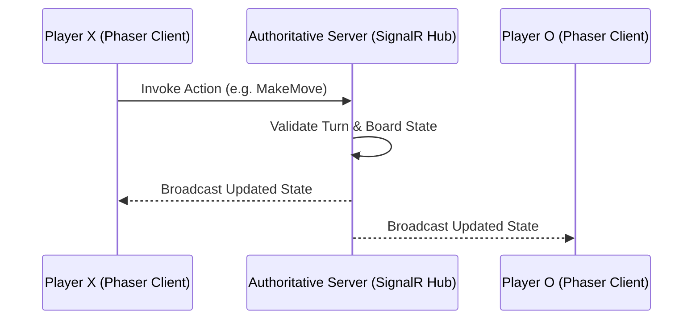

# <Topic / System Name>

*Brief 1-2 sentence summary: what this element is and what role it plays in Networking Tic-Tac-Toe.*

---

## 1. Overview & Purpose

Accessible explanation covering:
- What problem this system/feature solves.
- How it affects gameplay or networking from player and developer perspectives.
- Intuitive mental models to aid understanding.

## 2. Key Concepts

Glossary of key terms:
- **Concept A**: Simple and concise explanation.
- **Concept B**: Simple and concise explanation.

## 3. How It Works

Visual flowchart or sequence diagram of system operation:

Step-by-step description of what happens at each stage.

## 4. Usage & Configuration Guide

Practical guide for developers and users:
1. **Relevant Locations**: Where the key server and client files live (`server/`, `client/src/`).
2. **Step-by-Step**: How to run, extend, or configure the feature.
3. **Tips & Best Practices**: What to watch out for during development or testing.

## 5. Configuration & Constants Table

| Parameter / Constant | Location | Description | Default Value |
| :--- | :--- | :--- | :--- |
| `EXAMPLE_CONSTANT` | `server/...` | Parameter description | `3` |
| `HUB_ENDPOINT` | `client/src/...` | SignalR Hub route | `"/hubs/game"` |

## 6. FAQ & Troubleshooting

- **Q: What should I do when [common issue]?**  
  **A:** [Step-by-step resolution].
- **Q: How does this behave when a player disconnects?**  
  **A:** [Explanation of runtime behavior].
